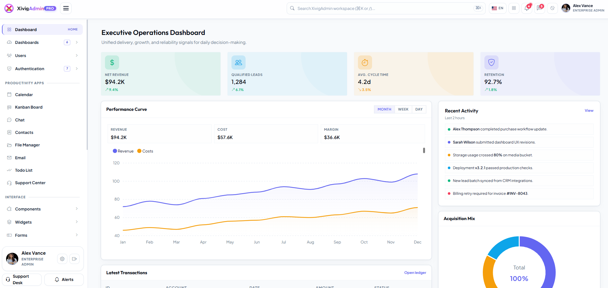

# XivigAdmin - Elite Modern Modular Admin Dashboard Template

<div align="center">



[](https://vitejs.dev/)
[](https://getbootstrap.com/)
[](https://sass-lang.com/)
[](https://developer.mozilla.org/)
[-success)](#)
[](https://quilljs.com/)
[-brightgreen)](#)

**XivigAdmin** is an ultra-refined, futuristic yet enterprise-ready responsive admin dashboard template. Engineered with modern **Vite** workflows, modular **Dart Sass (SCSS)**, lightweight **ES6+ modules (Zero jQuery)**, and the **Quill** rich text editor.

</div>

---

## 🌿 Git Branches & Repository Structure

| Branch | Description | Status |
| :--- | :--- | :--- |
| **`niceadmin-original`** | The complete original final NiceAdmin modular template preserved in its pristine state. | Preserved & Isolated |
| **`xivigadmin`** | The revamped, elite, modern, standout XivigAdmin dashboard suite with refreshed identity and assets. | **Active & Current** |

---

## ✨ Standout Features

- **💎 Elite Design System**:
  - Cosmic Obsidian Dark Mode (`#070a13` canvas, `#0d1322` surfaces, luminous accent glows) and Radiant Slate Light Mode.
  - Electric Indigo (`#6366f1`), Vivid Rose (`#f43f5e`), and Cyber Emerald (`#10b981`) accent palette inspired by the official Xivig identity.
  - Frosted glassmorphic header dock with `backdrop-filter: blur(16px)` and translucent rim light.
  - Modern typography pairing: **Plus Jakarta Sans** (UI body), **Outfit** (headings & display metrics), and **JetBrains Mono** (code & values).
  - Modern rounded curvatures (`10px`–`14px`), subtle keycap shortcuts (`<kbd>⌘K</kbd>`), and real-time live pulse badges (`.badge-pulse`).
- **⚡ High-Performance Developer Experience**:
  - Powered by **Vite** with instant Hot Module Replacement (HMR).
  - Automated layout and partial injection (`<layout src="..." />` and `<include src="..." />`).
  - Active navigation state and parent accordion submenus automatically expand to the exact current page.
- **🎨 Modular SCSS Architecture**:
  - 35 Dart Sass modules across `src/scss/` with modern `@use` rules, CSS custom property theming, and responsive utilities.
- **📜 100% Modular ES6+ (Zero jQuery)**:
  - Pure native JavaScript modules in `src/js/modules/` for Theme, Sidebar, Search, Tooltips, Apps, and Quill.
- **✍️ Quill Rich Text Editor**:
  - Full modern Quill integration with custom toolbar styling, bubble variants, and document editing.
- **📦 100% Standalone Production Build (`dist/`)**:
  - All 85 pages flatten to `dist/*.html` with normalized relative paths.
  - All images isolated cleanly into `dist/assets/img/`.
  - Works straight from disk with the `file:///` protocol (double-click `index.html` to run without a web server).

---

## 🚀 Quick Start

### 1. Prerequisites & Installation
Ensure [Node.js](https://nodejs.org/) (v18+) is installed.

```bash
# Clone the repository
git clone https://github.com/xivig/xivig-admin-template.git
cd nice-admin-template

# Switch to the XivigAdmin branch
git checkout xivigadmin

# Install dependencies
npm install
```

### 2. Development Server
Start the Vite development server with live reload and HMR:

```bash
npm run dev
```

Navigate to [http://localhost:5173](http://localhost:5173). Any changes in `src/pages/`, `src/scss/`, `src/js/`, `src/partials/`, or `src/layouts/` update instantaneously.

### 3. Production Build
Compile and bundle the entire standalone project into `dist/`:

```bash
npm run build
```

The build automatically:
1. Compiles and minifies SCSS to `dist/assets/css/main-[hash].css`.
2. Bundles ES modules to `dist/assets/js/main-[hash].js`.
3. Isolates all brand logos, illustrations, avatars, and icons into `dist/assets/img/`.
4. Flattens all 85 HTML pages into `dist/*.html` with standalone relative asset references.

### 4. Preview Build
Preview the compiled output using Vite's preview server:

```bash
npm run preview
```

---

## 📁 Directory Structure

```plaintext
xivig-admin-template/
├── src/
│   ├── pages/                   # 85 Modular HTML Pages
│   │   ├── index.html           # Executive Operations Dashboard
│   │   ├── dashboard-*.html     # Sales, CRM, Analytics, Projects, Finance, Marketing
│   │   ├── apps-*.html          # Calendar, Chat, Contacts, Email, Kanban, Todo, Support
│   │   ├── forms-*.html         # Elements, Editors (Quill), Pickers, Uploads, Wizards
│   │   ├── tables-*.html        # DataTables, Responsive, Basic Tables
│   │   ├── charts-*.html        # ApexCharts, Chart.js, ECharts
│   │   ├── components-*.html    # Modals, Offcanvas, Accordions, Toasts, Badges, etc.
│   │   ├── icons-*.html         # Bootstrap Icons, Lucide, Phosphor, FontAwesome, Remix
│   │   ├── auth-*.html          # Login, Register, Lockscreen, 2FA, Forgot Password
│   │   ├── error-*.html         # 404, 500, 403, Maintenance, Coming Soon
│   │   └── ...                  # Profile, Users, Settings, Invoices, Pricing, FAQ
│   ├── assets/
│   │   ├── img/                 # Xivig logos, illustrations, team photos, favicons
│   │   └── vendor/              # Bootstrap 5, Quill, ApexCharts, Flatpickr, Choices.js
│   ├── scss/                    # Dart Sass Architecture
│   │   ├── main.scss            # Main entry point
│   │   ├── _variables.scss      # Elite color systems, radii, shadows & tokens
│   │   ├── _base.scss           # Base resets, typography, custom scrollbars
│   │   ├── layouts/             # Header, Sidebar, Footer, Auth, Main layouts
│   │   ├── components/          # Cards, Buttons, Forms, Modals, Quill, Badges
│   │   ├── pages/               # Dashboard, Users, Widgets, Errors
│   │   └── utils/               # Helpers, Dark mode, Print styles
│   ├── js/                      # Pure ES6+ Modules (Zero jQuery)
│   │   ├── main.js              # Application bootstrapper
│   │   └── modules/             # Theme, Sidebar, Search, BackToTop, Tooltips, Apps, Quill
│   ├── layouts/                 # default.html, auth.html, error.html
│   └── partials/                # head.html, header.html, sidebar.html, footer.html, scripts.html
├── dist/                        # Production Output (100% Standalone & Flattened)
│   ├── *.html                   # 85 Standalone HTML files
│   └── assets/
│       ├── css/                 # Production minified stylesheet
│       ├── js/                  # Production minified bundles
│       ├── img/                 # Isolated production images
│       ├── fonts/               # Web fonts & icon sets
│       └── vendor/              # Bundled vendor libraries
├── vite.config.mjs              # Multi-page compiler & standalone pipeline
├── package.json                 # Project configuration
└── README.md                    # Documentation
```

---

## 🎨 Design System & Customization

### Theming & Colors
Theme tokens are managed in [`src/scss/_variables.scss`](file:///e:/0.2027-project/nice-admin-template/src/scss/_variables.scss). You can customize accents, radii, or shadows directly:

```scss
:root {
  --accent-color: #6366f1;           /* Electric Indigo */
  --brand-purple: #7c3aed;           /* Vibrant Violet */
  --brand-rose: #f43f5e;             /* Rose Accent */
  --radius-md: 0.625rem;             /* 10px Modern Radius */
  --bs-card-border-radius: 0.875rem; /* 14px Card Curvature */
}
```

Dark mode automatically engages when `data-theme="dark"` is set on `<html>`, switching to the obsidian palette with high-contrast glowing indicators.

---

## 📄 License & Credits

- **Identity & Template**: Developed by **Xivig Studio**.
- **Engine**: Powered by [Vite](https://vitejs.dev/) and [Bootstrap 5](https://getbootstrap.com/).
- **Original Base**: Preserved on git branch `niceadmin-original`.
- **License**: MIT License.
